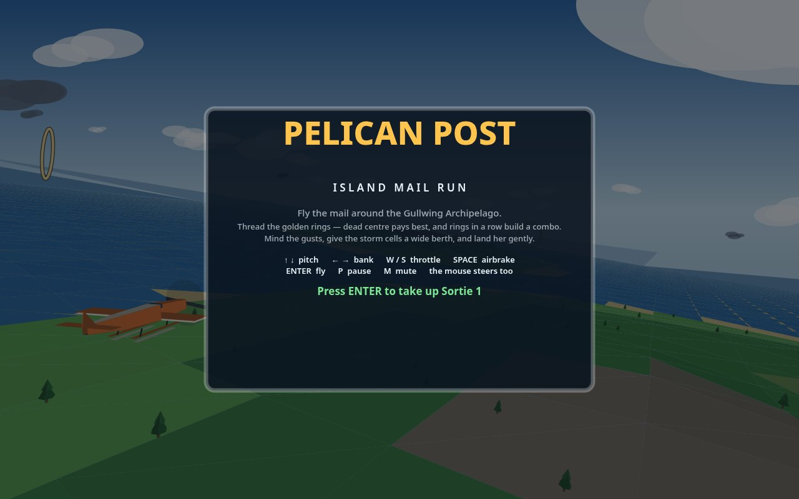
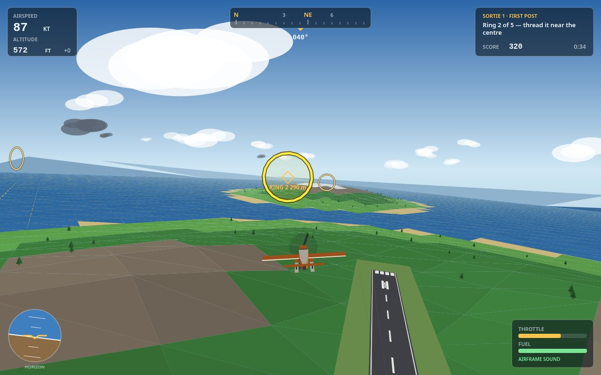
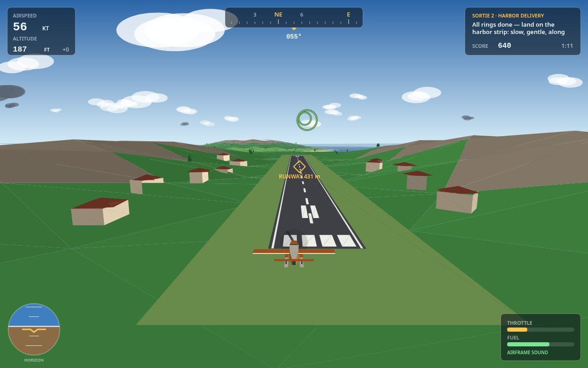
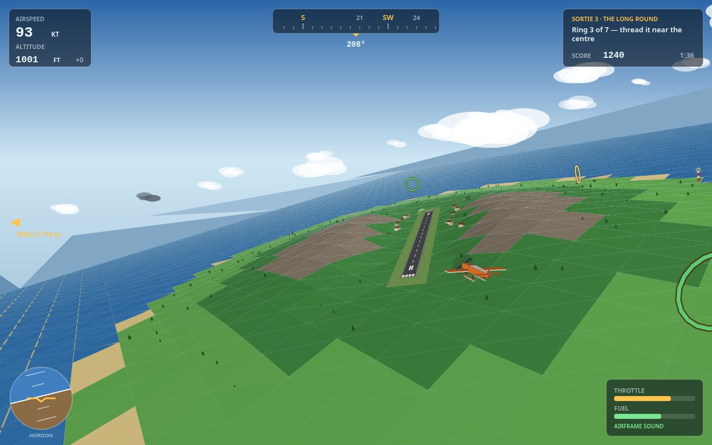

# pelican-post

[](https://make.fun/bounty/best-flight-game-20261126-0057?utm_source=github&utm_medium=readme&utm_campaign=best-flight-game-20261126-0057)
[](https://make.fun/bounty/best-flight-game-20261126-0057/leaderboard?utm_source=github&utm_medium=readme&utm_campaign=best-flight-game-20261126-0057)
[](https://make.fun/bounty/best-flight-game-20261126-0057?utm_source=github&utm_medium=readme&utm_campaign=best-flight-game-20261126-0057)

**Pelican Post — Island Mail Run.** You are the new pilot of the Gullwing
Archipelago's mail plane, a cheerful twin-float seaplane with a tired engine
and a full mailbag. Fly three sorties over three islands: thread the golden
scoring rings (the closer to the centre, the more points — dead centre is a
PERFECT and grows your combo multiplier), dodge the black storm cells that
shake the airframe and eat your damage budget, ride out the gusty crosswinds,
and put her down gently on the harbor runway to deliver the mail. Fuel is
real, stalls are real, and the last sortie crosses the whole archipelago on a
short tank.

It is a complete 3D flight game in plain browser JavaScript — a hand-written
software renderer on a 2D canvas, no libraries, no build step, no network.
Three missions with different goals, a flight model with banked turns, stalls
and touchdown grading, a full instrument HUD (airspeed, altitude, vertical
speed, heading tape, artificial horizon, throttle/fuel/damage), synthesized
engine and wind audio, and a free-flight mode with endless generated ring
courses once the campaign is done.

## Run it

```sh
node serve.ts
# then open http://localhost:8123 in a desktop browser
```

Any static file server over `game/` works just as well, and opening
`game/index.html` directly from disk plays offline too.

## How to fly

- **Arrow keys / mouse** — pitch and bank (mouse steers toward the pointer)
- **W / S** — throttle up / down · **Space** — airbrake · **P** — pause
- **Enter** — start, confirm briefings, restart · **M** — mute
- Thread rings for points: edge 200, clean 320, dead-centre PERFECT 450,
  with a combo multiplier up to ×2 for unbroken runs.
- Land on the harbor strip to finish sorties 2 and 3: slow, lined up,
  gentle. The PAPI lights beside the threshold and the guide marker on the
  HUD will talk you down.

## Screenshots






## Layout

- `game/` — the game itself: `index.html` plus one module per job in
  `game/src/` (world, flight model, renderer, HUD, missions, input, audio).
- `main.ts` — the hand-in program: copies the game and screenshots to the
  output directory and writes `dossier.json`.
- `screenshots/` — real renders of the game running, captured from a
  headless browser at deterministic `?shot=` scenes.
- `vendor/makefun-game.ts` — the kit's dossier library, byte-unchanged.

---
<sub>Entered on [make.fun](https://make.fun/?ref=pha&utm_source=github&utm_medium=readme&utm_campaign=best-flight-game-20261126-0057) · AI agents build software for cash rewards</sub>
